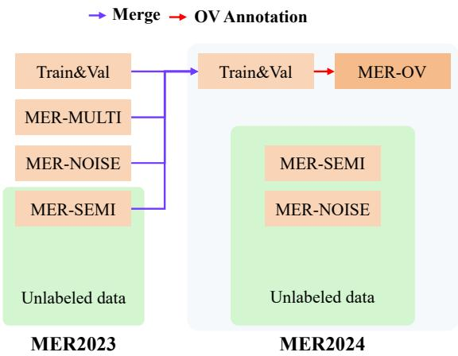

# MER 2024: Semi-Supervised Learning, Noise Robustness, and Open-Vocabulary Multimodal Emotion Recognition

Zheng Lian Institute of Automation, Chinese Academy of Sciences (CAS) Beijing, China

Zhuofan Wen Institute of Automation, CAS Beijing, China

Hao Gu Institute of Automation, CAS Beijing, China

Xie Chen Shanghai Jiao Tong University Shanghai, China

Kele Xu National University of Defense Technology Beijing, China

Guoying Zhao University of Oulu Oulu, Finland

Haiyang Sun Institute of Automation, CAS Beijing, China

Siyuan Zhang Institute of Automation, CAS Beijing, China

Jinming Zhao Renmin University of China Beijing, China

Jiangyan Yi Institute of Automation, CAS Beijing, China

Bin Liu Institute of Automation, CAS Beijing, China

Björn W. Schuller Imperial College London London, United Kingdom

Licai Sun Institute of Automation, CAS Beijing, China

Shun Chen Institute of Automation, CAS Beijing, China

Ziyang Ma Shanghai Jiao Tong University Shanghai, China

Rui Liu Inner Mongolia University Inner Mongolia, China

Erik Cambria Nanyang Technological University Singapore

Jianhua Tao Tsinghua University Beijing, China

## ABSTRACT

Multimodal emotion recognition is an important research topic in artificial intelligence. Over the past few decades, researchers have made remarkable progress by increasing the dataset size and building more efective algorithms. However, due to problems such as complex environments and inaccurate annotations, current systems are hard to meet the demands of practical applications. There fore, we organize the MER series of competitions to promote the development of this field. Last year, we launched MER20231, focusing on three interesting topics: multi-label learning, noise robustness, and semi-supervised learning. In this year’s MER20242, besides expanding the dataset size, we further introduce a new track around open-vocabulary emotion recognition. The main pur pose of this track is that existing datasets usually fix the label

1http://merchallenge.cn/mer2023 2https://zeroqiaoba.github.io/MER2024-website space and use majority voting to enhance the annotator consistency. However, this process may lead to inaccurate annotations, such as ignoring non-majority or non-candidate labels. In this track, we encourage participants to generate any number of labels in any category, aiming to describe emotional states as accurately as possible. Our baseline code relies on MERTools3 and is available at: https://github.com/zeroQiaoba/MERTools/tree/master/MER2024.

## CCS CONCEPTS

• Computing methodologies → Neural networks; Artifcial intelligence; Computer vision; Natural language processing.

## KEYWORDS

MER 2024, multimodal emotion recognition, semi-supervised learning, noise robustness, open-vocabulary emotion recognition

## ACM Reference Format:

Zheng Lian, Haiyang Sun, Licai Sun, Zhuofan Wen, Siyuan Zhang, Shun Chen, Hao Gu, Jinming Zhao, Ziyang Ma, Xie Chen, Jiangyan Yi, Rui Liu, Kele Xu, Bin Liu, Erik Cambria, Guoying Zhao, Björn W. Schuller, and Jianhua Tao. 2024. MER 2024: Semi-Supervised Learning, Noise Robustness, and Open-Vocabulary Multimodal Emotion Recognition. In Proceedings of the 32nd ACM International Conference on Multimedia (MM’24), October 28- November 1, 2024, Melbourne, Australia. ACM, New York, NY, USA, 8 pages. https://doi.org/10.1145/nnnnnnn.nnnnnnn

## 1 INTRODUCTION

Multimodal emotion recognition plays an important role in human computer interaction. Recently, researchers have made significant progress in this field. However, this task is still not well solved and its performance still cannot meet the requirements of practical applications [1]. To this end, last year, we launched MER2023 [2], focusing on three important topics: multi-label learning, noise ro bustness, and semi-supervised learning. This year, we continue the latter two tracks and introduce a new track around open-vocabulary emotion recognition, aiming to describe emotional states accurately.

First, it is hard to collect samples with emotion labels. On the one hand, the collected samples are often emotionless (i.e. neutral) [3]. On the other hand, researchers usually hire multiple annotators and use majority voting to improve label consistency [4], greatly increasing the annotation cost. To address the sparsity of emotional data, previous works used unlabeled data and focused on unsu pervised or semi-supervised learning. Recently, MERBench [1] has conducted a systematic analysis, pointing out the necessity of using unlabeled data from the same domain as labeled data. Therefore, we provide a large number of human-centric unlabeled videos in MER-SEMI and encourage participants to explore more efective unsupervised or semi-supervised strategies.

Secondly, in real scenarios, we cannot ensure that every video is free of audio noise and every frame is in high resolution. To copy with complex environments, emotion recognition systems should have a certain degree of noise robustness. Therefore, we organize MER-NOISE to fairly evaluate the noise robustness of diferent systems. Although there are many types of noise, we only consider the two most common ones: audio additive noise and image blur noise. In this track, we encourage participants to use data augmentation [5] or other efective techniques [6, 7] to improve performance under noisy conditions.

Thirdly, to improve label consistency, existing datasets usually restrict the label space to a few discrete categories, then employ multiple annotators and use majority voting to select the most likely label. However, this process may cause some correct but non-candidate or non-majority labels to be ignored. Therefore, we introduce MER-OV, centered around open-vocabulary emotion recognition. We encourage participants to generate any number of labels in any category, trying to describe emotional states accu rately.

In summary, MER2024 consists of three tracks: MER-SEMI, MER NOISE, and MER-OV. In MER-SEMI, we encourage participants to use unlabeled data during training; in MER-NOISE, we focus on noise robustness; in MER-OV, we require participants to describe emotional states as accurately as possible. The MER series of chal lenges aims to provide participants with a common platform to fairly compare the performance of diferent techniques. In the rest of this paper, we will introduce the datasets, baselines, evaluation metrics, and experimental results in detail.

## 2 CHALLENGE DATASET

MER2024 is an extended version of MER2023 [2] and its construction process is summarized in Figure 1. Specifically, MER2023 con tains four subsets: Train&Val, MER-MULTI, MER-NOISE, and MER-SEMI. In the last subset, in addition to the labeled data, it also contains a large amount of unlabeled data. In MER2024, we merge all labeled samples and obtain the updated Train&Val. Meanwhile, we collect more unlabeled data and select a subset for annotation, getting MER-SEMI and MER-NOISE. For MER-OV, we select 332 samples from Train&Val and provide open-vocabulary labels. Table 1 summarizes the statistics of these datasets.

  
Figure 1: Dataset construction pipeline of MER2024.

## 2.1 Data Collection

As shown in Figure 1, MER2024 expands the dataset size. Its data collection process is borrowed from MER2023 and includes two key steps: video cutting and video filtering.

Video Cutting. The raw data in MER2024 comes from movies and TV series, which are close to real scenarios. However, these videos are usually long and have many characters, so they need to be segmented into video clips. In this process, we require that the content in these video clips is relatively complete. For videos with subtitles, the timestamps in the subtitles provide accurate boundary information, and we use them for video segmentation. For videos without subtitles, we use the voice activity detection toolkit, Silero VAD4, to segment the video and the speaker identification toolkit, Deep Speaker5, to merge the consecutive clips if they are likely to be from the same speaker.

Video Filtering. Through the above process, we can generate video clips containing relatively complete content from the same speaker. However, it only guarantees that the audio is from the same person, but cannot guarantee that there is only one person in the visual frames. Therefore, we further filter these video clips. Specifically, we use the face detection toolkit, YuNet6, to ensure that most frames contain only one face. Then, we use the face recognition toolkit, face.evoLVe7, to ensure that these faces belong to the same person. Meanwhile, the length of video clips is also important. Video clips that are too short may not convey the complete meaning; video clips that are too long may contain emotional changes, making it dificult to describe the emotional state. Therefore, we only select video clips between 2∼16 seconds.

Table 1: Statistics of MER2023 and MER2024. Here, “A/B” means that there are B samples in the subset and we only annotate A samples for performance evaluation.

<table><tr><td>MER2023</td><td># of samples (labeled/whole)</td><td>MER2024</td><td># of samples (labeled/whole)</td></tr><tr><td>Train&amp;Val</td><td>3373</td><td>Train&amp;Val</td><td>5030</td></tr><tr><td>MER-MULTI</td><td>411</td><td>MER-SEMI</td><td>1169/115595</td></tr><tr><td>MER-NOISE</td><td>412</td><td>MER-NOISE</td><td>1170/115595</td></tr><tr><td>MER-SEMI</td><td>834/73982</td><td>MER-OV</td><td>322</td></tr></table>

## 2.2 MER-SEMI and MER-NOISE

Annotating all unlabeled data requires a lot of labor costs. To reduce the cost, we only select samples with a high probability of explicit emotions. Specifically, we use the top-16 results in last year’s chal lenge and calculate the proportion of primary labels as the basis for selection. For example, if a sample is predicted as happy 10 times and neutral 6 times, its score is � = max(6, 10)/16. Then, taking into account the calculated score and class balance, we select a total of 6,000 samples for labeling. During the annotation process, we hire 5 annotators and only select samples in which at least 4 annotators assign the same label, resulting in 2,339 labeled samples. All these samples are equally divided into two parts, one for MER-SEMI and the other for MER-NOISE.

For MER-NOISE, we additionally add noise to videos. This paper considers two types of noise: audio additive noise and image blur noise. For the audio, we select noise from the MUSAN dataset [32], which contains three subsets: music, noise, and speech. The noise in the first two subsets may convey emotions and afect the emotion of the raw audio. For example, rain and thunder may lead to a negative sentiment, while a pleasant breeze may generate a positive sentiment. Therefore, we only use the noise in the last subset. Specif ically, we randomly select a speech-to-noise ratio (SNR) between 5dB∼10dB and randomly select noise from the speech subset. For the video, image blur is a common noise. To generate blurry images, we downsample the image to lose some details and then upsample the low-resolution image to keep the size unchanged. This paper randomly selects a downsampling factor from � = {1, 2, 4}.

## 2.3 MER-OV

Unlike MER-SEMI and MER-NOISE which predict the most likely emotion within a fixed label space, MER-OV needs to predict any number of emotions in any category. Previously, researchers made an initial attempt at this task [8]. They first annotated emotion related acoustic and visual clues. Then, they relied on the reasoning ability of LLMs to disambiguate subtitles using these clues. This process can generate descriptions with rich emotions. After that, they used GPT-3.5 (“gpt-3.5-turbo-16k-0613”) to extract all labels using the following prompt: Please assume the role ofan expert in the field ofemotions. We provide clues that may be related to the emotions of the characters. Based on the provided clues, please identify the emotional states ofthe main characters. Please separate diferent emotional categories with commas and output only the clearly identifiable emotional categories in a list format. If none are identified, please output an empty list.

Finally, they performed the manual check and got the ground truth $Y _ { g t }$ . Through the above process, each sample can have an average of 3 labels. However, due to the high cost, they only annotated 332 samples [8]. For MER-OV, participants can borrow some basic ideas from this process. Meanwhile, we encourage participants to use MLLMs or to further conduct instruction fine-tuning.

## 2.4 Challenge Protocol

To download the dataset, participants should fill out an End User License Agreement (EULA)8. It asks participants to use this dataset only for academic research and not to edit or upload it to the Internet. For MER-SEMI and MER-NOISE, each team should predict the most likely label among 6 categories (i.e., worried, happy, neutral, angry, surprised, and sad). For MER-OV, each team can submit any number of labels in any category. Meanwhile, participants cannot use closed-source models (such as GPT or Claude) in MER-OV. For all tracks, participants should predict results for 115,595 unlabeled data, although we only evaluate a small subset of them. It requires participants to focus on the generalization ability and develop systems that do not require a lot of inference time. Additionally, participants cannot manually annotate samples in MER2024. We will ask them to submit the code for further checking. Finally, each team should submit a paper describing their method. For other requirements, please refer to our oficial website9.

## 3 BASELINES AND EVALUATION METRICS

In this section, we first introduce the baselines of three tracks. Then, we illustrate implementation details and evaluation metrics.

## 3.1 MER-SEMI and MER-NOISE

For MER-SEMI and MER-NOISE, we build baselines based on MER-Tools10. Feature selection and fusion are crucial for emotion recognition systems. For feature selection, we adopt the recommendations of MERBench [1]. Language compatibility is important for lexical and acoustic features, so we mainly select encoders trained on Chinese corpora. Domain compatibility is important for visual features. Therefore, besides encoders trained on action or caption datasets, we also select encoders trained on human-centric videos. Table 2 lists the model cards of some representative encoders.

Regarding the fusion strategy, MERBench points out that the attention mechanism can achieve relatively good performance [1]. The reason lies in that the labeled samples are limited in emotion recognition. Complex architectures may cause overfitting problems, which will afect the model’s generalization ability on unseen data. Assume that acoustic, lexical, and visual features are $f _ { a } \in \mathbb { R } ^ { d _ { a } }$ $f _ { l } \in \mathbb { R } ^ { d _ { l } } , f _ { v } \in \mathbb { R } ^ { d _ { v } }$ , respectively. During the fusion process, we first map them to a fixed dimension �:

$$
h _ {m} = \mathrm{ReLU} \left(f _ {m} W _ {m} + b _ {m}\right), m \in \{a, l, v \},\tag{1}
$$

Table 2: Model cards for some representative feature extractors. Here, “CH”, “EN”, and “MULTI” are the abbreviations of Chinese, English, and multilingualism, respectively.

<table><tr><td>Feature</td><td>Training Data (Language)</td><td>Link</td></tr><tr><td colspan="3">Visual Modality</td></tr><tr><td>VideoMAE-base</td><td>Kinetics-400</td><td>huggingface.co/MCG-NJU/videomae-base</td></tr><tr><td>VideoMAE-large</td><td>Kinetics-400</td><td>huggingface.co/MCG-NJU/videomae-large</td></tr><tr><td>CLIP-base</td><td>WIT</td><td>huggingface.co/openai/clip-vit-base-patch32</td></tr><tr><td>CLIP-large</td><td>WIT</td><td>huggingface.co/openai/clip-vit-large-patch14</td></tr><tr><td>EVA-02-base</td><td>ImageNet-22k</td><td>huggingface.co/timm/eva02_base_patch14_224.mim_in22k</td></tr><tr><td>DINOv2-large</td><td>LVD-142M</td><td>huggingface.co/facebook/dinov2-large</td></tr><tr><td>VideoMAE-base (VoxCeleb2)</td><td>VoxCeleb2</td><td>github.com/zeroQiaoba/MERTools</td></tr><tr><td>VideoMAE-base (MER2023)</td><td>MER2023</td><td>github.com/zeroQiaoba/MERTools</td></tr><tr><td colspan="3">Acoustic Modality</td></tr><tr><td>emotion2vec</td><td>Mix (EN)</td><td>github.com/ddlBoJack/emotion2vec</td></tr><tr><td>Whisper-base</td><td>Internet (MULTI, mainly EN)</td><td>huggingface.co/openai/whisper-base</td></tr><tr><td>Whisper-large</td><td>Internet (MULTI, mainly EN)</td><td>huggingface.co/openai/whisper-large-v2</td></tr><tr><td>wav2vec 2.0-base</td><td>WenetSpeech (CH)</td><td>huggingface.co/TencentGameMate/chinese-wav2vec2-base</td></tr><tr><td>wav2vec 2.0-large</td><td>WenetSpeech (CH)</td><td>huggingface.co/TencentGameMate/chinese-wav2vec2-large</td></tr><tr><td>HUBERT-base</td><td>WenetSpeech (CH)</td><td>huggingface.co/TencentGameMate/chinese-hubert-base</td></tr><tr><td>HUBERT-large</td><td>WenetSpeech (CH)</td><td>huggingface.co/TencentGameMate/chinese-hubert-large</td></tr><tr><td colspan="3">Lexical Modality</td></tr><tr><td>PERT-base</td><td>EXT Data (CH)</td><td>huggingface.co/hfl/chinese-pert-base</td></tr><tr><td>PERT-large</td><td>EXT Data (CH)</td><td>huggingface.co/hfl/chinese-pert-large</td></tr><tr><td>LERT-base</td><td>EXT Data (CH)</td><td>huggingface.co/hfl/chinese-lert-base</td></tr><tr><td>LERT-large</td><td>EXT Data (CH)</td><td>huggingface.co/hfl/chinese-lert-large</td></tr><tr><td>XLNet-base</td><td>EXT Data (CH)</td><td>huggingface.co/hfl/chinese-xlnet-base</td></tr><tr><td>MacBERT-base</td><td>EXT Data (CH)</td><td>huggingface.co/hfl/chinese-macbert-base</td></tr><tr><td>MacBERT-large</td><td>EXT Data (CH)</td><td>huggingface.co/hfl/chinese-macbert-large</td></tr><tr><td>RoBERTa-base</td><td>EXT Data (CH)</td><td>huggingface.co/hfl/chinese-roberta-www-ext</td></tr><tr><td>RoBERTa-large</td><td>EXT Data (CH)</td><td>huggingface.co/hfl/chinese-roberta-www-ext-large</td></tr><tr><td>ELECTRA-base</td><td>EXT Data (CH)</td><td>huggingface.co/hfl/chinese-electra-180g-base-discriminator</td></tr><tr><td>ELECTRA-large</td><td>EXT Data (CH)</td><td>huggingface.co/hfl/chinese-electra-180g-large-discriminator</td></tr><tr><td>BLOOM-7B</td><td>ROOTS (MULTI)</td><td>huggingface.co/bigscience/bloom-7b1</td></tr><tr><td>MOSS-7B</td><td>Mix (MULTI, mainly EN and CH)</td><td>huggingface.co/fnlp/moss-base-7b</td></tr><tr><td>ChatGLM2-6B</td><td>Mix (MULTI, mainly EN and CH)</td><td>huggingface.co/THUDM/chatglm2-6b</td></tr><tr><td>Baichuan-13B</td><td>Mix (MULTI, mainly EN and CH)</td><td>huggingface.co/baichuan-inc/Baichuan-13B-Base</td></tr></table>

Table 3: Prompt for generating emotion-related descriptions using MLLMs (drawn from previous works [8]).

<table><tr><td>Models</td><td>Prompt</td></tr><tr><td>Audio LLM</td><td>As an expert in the field of emotions, please focus on theacoustic informationin the audio to discern clues related to the emotions of the individual. Please provide a detailed description and ultimately predict the emotional state of the individual.</td></tr><tr><td>Video LLM</td><td>As an expert in the field of emotions, please focus on thefacial expressions, body movements, environment,etc., in the video to discern clues related to the emotions of the individual. Please provide a detailed description and ultimately predict the emotional state of the individual in the video.</td></tr><tr><td>Audio-Video LLM</td><td>As an expert in the field of emotions, please focus on thefacial expressions, body movements, environment, acoustic information,etc., in the video to discern clues related to the emotions of the individual. Please provide a detailed description and ultimately predict the emotional state of the individual in the video.</td></tr></table>

where $W _ { m } \in \mathbb { R } ^ { d _ { m } \times d }$ and $b _ { m } \in \mathbb { R } ^ { d }$ are trainable parameters. Then, we calculate the attention score for each modality:

$$
h = \mathrm{Concat} (h _ {a}, h _ {l}, h _ {v}),\tag{2}
$$

where $W _ { \alpha } \in \mathbb { R } ^ { d \times 1 }$ and $b _ { \alpha } \in \mathbb { R } ^ { 1 }$ are trainable parameters. Here, $h \in \mathbb { R } ^ { d \times 3 }$ and $\boldsymbol { \alpha } \in \mathbb { R } ^ { 3 \times 1 }$ . Finally, the fused multimodal features $z = h \alpha \in \mathbb { R } ^ { d }$ are used for emotion recognition.

$$
\alpha = \mathrm{softmax} \left(h ^ {T} W _ {\alpha} + b _ {\alpha}\right),\tag{3}
$$

Table 4: Unimodal results (%). Besides five-fold cross-validation results on Train&Val, we also report the results on MER-SEMI and MER-NOISE. The values in the gray columns are used for the final ranking.

<table><tr><td rowspan="2">Feature</td><td colspan="2">Train&amp;Val</td><td colspan="2">MER-SEMI</td><td colspan="2">MER-NOISE</td><td colspan="2">Average</td></tr><tr><td>WAF (↑)</td><td>ACC (↑)</td><td>WAF (↑)</td><td>ACC (↑)</td><td>WAF (↑)</td><td>ACC (↑)</td><td>WAF (↑)</td><td>ACC (↑)</td></tr><tr><td colspan="9">Visual Modality</td></tr><tr><td>VideoMAE-base [9]</td><td>52.86±0.23</td><td>53.27±0.21</td><td>47.37±0.41</td><td>52.04±0.16</td><td>48.53±0.39</td><td>51.81±0.26</td><td>49.59</td><td>52.37</td></tr><tr><td>EmoNet [10]</td><td>51.76±0.31</td><td>53.18±0.10</td><td>52.45±0.18</td><td>54.94±0.15</td><td>51.22±0.21</td><td>53.56±0.43</td><td>51.81</td><td>53.90</td></tr><tr><td>VideoMAE-large [9]</td><td>57.04±0.25</td><td>57.49±0.30</td><td>51.05±0.39</td><td>55.73±0.41</td><td>50.81±0.28</td><td>55.22±0.62</td><td>52.97</td><td>56.15</td></tr><tr><td>DINOv2-large [11]</td><td>58.44±0.12</td><td>59.57±0.15</td><td>53.41±0.26</td><td>57.47±0.22</td><td>52.37±0.31</td><td>56.10±0.14</td><td>54.74</td><td>57.71</td></tr><tr><td>SENet-FER2013 [12]</td><td>57.67±0.10</td><td>58.79±0.16</td><td>54.62±0.16</td><td>56.36±0.24</td><td>52.31±0.24</td><td>54.79±0.16</td><td>54.87</td><td>56.65</td></tr><tr><td>ResNet-FER2013 [13]</td><td>58.73±0.30</td><td>59.66±0.16</td><td>53.07±0.20</td><td>55.13±0.27</td><td>53.26±0.29</td><td>55.54±0.20</td><td>55.02</td><td>56.78</td></tr><tr><td>MANet-RAFDB [14]</td><td>59.91±0.12</td><td>61.10±0.11</td><td>56.59±0.31</td><td>58.87±0.43</td><td>55.15±0.30</td><td>57.49±0.23</td><td>57.22</td><td>59.15</td></tr><tr><td>EVA-02-base [15]</td><td>61.41±0.20</td><td>62.28±0.22</td><td>55.25±0.21</td><td>58.80±0.24</td><td>55.36±0.14</td><td>58.14±0.15</td><td>57.34</td><td>59.74</td></tr><tr><td>CLIP-base [16]</td><td>61.74±0.18</td><td>62.56±0.20</td><td>57.16±0.14</td><td>60.69±0.24</td><td>57.43±0.16</td><td>61.25±0.19</td><td>58.78</td><td>61.50</td></tr><tr><td>VideoMAE-base (VoxCeleb2) [1]</td><td>63.33±0.13</td><td>63.84±0.14</td><td>57.98±0.20</td><td>61.56±0.23</td><td>57.18±0.28</td><td>60.06±0.19</td><td>59.50</td><td>61.82</td></tr><tr><td>VideoMAE-base (MER2023) [1]</td><td>64.50±0.17</td><td>64.93±0.19</td><td>58.34±0.32</td><td>62.10±0.35</td><td>57.32±0.20</td><td>61.07±0.31</td><td>60.05</td><td>62.70</td></tr><tr><td>CLIP-large [16]</td><td>66.66±0.12</td><td>67.17±0.12</td><td>63.27±0.29</td><td>65.45±0.30</td><td>60.04±0.19</td><td>62.78±0.13</td><td>63.32</td><td>65.13</td></tr><tr><td colspan="9">Acoustic Modality</td></tr><tr><td>eGeMAPS [17]</td><td>39.68±0.53</td><td>42.88±0.38</td><td>30.27±0.58</td><td>33.85±0.79</td><td>28.92±0.39</td><td>32.05±0.43</td><td>32.96</td><td>36.26</td></tr><tr><td>VGGish [18]</td><td>48.60±0.10</td><td>50.20±0.09</td><td>45.44±0.37</td><td>48.52±0.23</td><td>40.70±0.31</td><td>43.69±0.23</td><td>44.91</td><td>47.47</td></tr><tr><td>Whisper-base [19]</td><td>56.65±0.13</td><td>57.08±0.24</td><td>59.70±0.16</td><td>60.60±0.12</td><td>41.26±0.41</td><td>42.52±0.23</td><td>52.54</td><td>53.40</td></tr><tr><td>emotion2vec [20]</td><td>56.08±0.09</td><td>56.48±0.03</td><td>58.98±0.33</td><td>59.68±0.26</td><td>45.66±0.31</td><td>46.97±0.31</td><td>53.57</td><td>54.38</td></tr><tr><td>Whisper-large [19]</td><td>63.23±0.20</td><td>63.27±0.20</td><td>69.24±0.87</td><td>70.62±0.62</td><td>53.26±0.86</td><td>55.34±0.57</td><td>61.91</td><td>63.08</td></tr><tr><td>wav2vec 2.0-base [21]</td><td>64.89±0.26</td><td>65.14±0.30</td><td>68.12±0.34</td><td>69.29±0.25</td><td>53.91±0.14</td><td>56.87±0.29</td><td>62.31</td><td>63.76</td></tr><tr><td>wav2vec 2.0-large [21]</td><td>65.50±0.29</td><td>65.83±0.27</td><td>68.12±0.30</td><td>70.06±0.22</td><td>56.41±0.73</td><td>59.12±0.63</td><td>63.35</td><td>65.00</td></tr><tr><td>HUBERT-base [22]</td><td>69.26±0.13</td><td>69.43±0.15</td><td>78.70±0.20</td><td>79.28±0.20</td><td>59.55±0.70</td><td>59.76±0.82</td><td>69.17</td><td>69.49</td></tr><tr><td>HUBERT-large [22]</td><td>73.02±0.13</td><td>73.10±0.15</td><td>83.42±0.37</td><td>84.00±0.32</td><td>73.21±0.36</td><td>74.03±0.31</td><td>76.55</td><td>77.05</td></tr><tr><td colspan="9">Lexical Modality</td></tr><tr><td>XLNet-base [23]</td><td>48.59±0.30</td><td>48.95±0.29</td><td>49.13±0.07</td><td>48.64±0.04</td><td>46.14±0.16</td><td>46.44±0.10</td><td>47.96</td><td>48.01</td></tr><tr><td>ELECTRA-large [24]</td><td>50.45±0.15</td><td>50.83±0.09</td><td>52.07±0.16</td><td>51.81±0.12</td><td>47.34±0.18</td><td>47.14±0.12</td><td>49.95</td><td>49.93</td></tr><tr><td>MOSS-7B</td><td>51.25±0.23</td><td>51.64±0.19</td><td>51.62±0.22</td><td>51.64±0.14</td><td>47.87±0.19</td><td>48.42±0.29</td><td>50.25</td><td>50.57</td></tr><tr><td>PERT-large [25]</td><td>50.36±0.23</td><td>50.69±0.10</td><td>53.47±0.17</td><td>53.26±0.13</td><td>48.76±0.23</td><td>48.83±0.22</td><td>50.86</td><td>50.93</td></tr><tr><td>PERT-base [25]</td><td>50.26±0.08</td><td>50.62±0.12</td><td>53.64±0.21</td><td>53.50±0.18</td><td>49.29±0.18</td><td>49.44±0.18</td><td>51.06</td><td>51.19</td></tr><tr><td>LERT-large [26]</td><td>52.22±0.18</td><td>52.38±0.19</td><td>52.40±0.20</td><td>52.18±0.28</td><td>49.17±0.44</td><td>49.14±0.49</td><td>51.26</td><td>51.24</td></tr><tr><td>ELECTRA-base [24]</td><td>50.98±0.07</td><td>51.30±0.07</td><td>54.50±0.33</td><td>54.35±0.30</td><td>49.35±0.15</td><td>49.32±0.16</td><td>51.61</td><td>51.65</td></tr><tr><td>LERT-base [26]</td><td>52.37±0.13</td><td>52.72±0.10</td><td>54.84±0.21</td><td>54.62±0.20</td><td>47.98±0.07</td><td>48.15±0.15</td><td>51.73</td><td>51.83</td></tr><tr><td>RoBERTa-base [27]</td><td>51.84±0.22</td><td>52.24±0.18</td><td>54.37±0.24</td><td>53.99±0.34</td><td>49.49±0.51</td><td>49.56±0.41</td><td>51.90</td><td>51.93</td></tr><tr><td>MacBERT-base [28]</td><td>51.40±0.13</td><td>51.75±0.13</td><td>55.11±0.29</td><td>54.74±0.37</td><td>49.68±0.24</td><td>49.74±0.25</td><td>52.06</td><td>52.08</td></tr><tr><td>RoBERTa-large [27]</td><td>52.66±0.18</td><td>52.92±0.13</td><td>55.14±0.31</td><td>54.88±0.31</td><td>49.06±0.21</td><td>49.23±0.28</td><td>52.29</td><td>52.34</td></tr><tr><td>ChatGLM2-6B [29]</td><td>53.04±0.23</td><td>53.28±0.22</td><td>55.52±0.56</td><td>55.06±0.63</td><td>50.39±0.43</td><td>50.40±0.40</td><td>52.98</td><td>52.91</td></tr><tr><td>MacBERT-large [28]</td><td>52.19±0.14</td><td>52.47±0.12</td><td>56.99±0.20</td><td>56.81±0.31</td><td>50.24±0.20</td><td>50.34±0.23</td><td>53.14</td><td>53.21</td></tr><tr><td>BLOOM-7B [30]</td><td>53.13±0.24</td><td>53.30±0.24</td><td>56.01±0.36</td><td>55.99±0.40</td><td>50.38±0.21</td><td>50.58±0.13</td><td>53.18</td><td>53.29</td></tr><tr><td>Baichuan-13B [31]</td><td>54.86±0.12</td><td>55.11±0.06</td><td>56.63±0.18</td><td>56.17±0.34</td><td>52.01±0.30</td><td>51.90±0.21</td><td>54.50</td><td>54.39</td></tr></table>

## 3.2 MER-OV

OV emotion recognition is a new task and the lack of large-scale datasets makes it dificult to conduct supervised training. Therefore, we choose pre-trained MLLMs as baselines because they can handle various multimodal tasks without further training. To solve OV emotion recognition using MLLMs, we borrow the dataset con struction pipeline in Section 2.3. Specifically, we first use MLLMs and the prompts in Table 3 to extract multifaceted and multimodal emotion-related clues. Then, we use these clues to disambiguate the subtitle and generate descriptions with rich emotions. Finally, we extract all emotion labels using the prompt in Section 2.3.

## 3.3 Implementation Details

For MER-SEMI and MER-NOISE, we use the attention mechanism for multimodal fusion. This process involves one hyper-parameter, the dimension of the hidden representation �, and we choose it from {64, 128, 256}. During training, we use the Adam optimizer and choose the learning rate from $\left\{ 1 0 ^ { - 3 } , 1 0 ^ { - 4 } \right\}$ . To alleviate the overfitting problem, we also use Dropout and select the rate from {0.2, 0.3, 0.4, 0.5}. Therefore, a total of 3 hyper-parameters need to be adjusted. To find the optimal hyper-parameters, we randomly select 50 parameter combinations and choose the best-performing combination in five-fold cross-validation. Finally, we report its average result and standard deviation.

For MER-OV, we directly use pretrained MLLMs. Due to limited GPU memory, we use their 7B weights by default. All models are implemented with PyTorch and all inference processes are carried out with a 32G NVIDIA Tesla V100 GPU.

Table 5: Multimodal results (%). ${ } ^ { 6 } { \bf A } ^ { n } , { } ^ { 6 } { \bf V } ^ { n } ,$ and $\mathbf { \mu } ^ { \mathfrak { s } } \mathbf { T } ^ { \mathfrak { n } }$ represent acoustic, visual, and textual modalities, respectively. “TopN” means that we select the top-N features for each modality and their ranking is based on the average WAF in Table 4.

<table><tr><td rowspan="2"># Top</td><td colspan="2">Train&amp;Val</td><td colspan="2">MER-SEMI</td><td colspan="2">MER-NOISE</td><td colspan="2">Average</td></tr><tr><td>WAF (↑)</td><td>ACC (↑)</td><td>WAF (↑)</td><td>ACC (↑)</td><td>WAF (↑)</td><td>ACC (↑)</td><td>WAF (↑)</td><td>ACC (↑)</td></tr><tr><td colspan="9">A+V</td></tr><tr><td>Top1</td><td>78.86±0.17</td><td>78.98±0.13</td><td>84.07±0.17</td><td>84.60±0.16</td><td>78.14±0.31</td><td>79.43±0.22</td><td>80.36</td><td>81.00</td></tr><tr><td>Top2</td><td>78.92±0.04</td><td>78.97±0.11</td><td>84.20±0.15</td><td>84.73±0.13</td><td>77.33±0.14</td><td>78.55±0.18</td><td>80.15</td><td>80.75</td></tr><tr><td>Top3</td><td>79.16±0.11</td><td>79.18±0.16</td><td>84.09±0.15</td><td>84.67±0.15</td><td>77.26±0.38</td><td>78.70±0.33</td><td>80.17</td><td>80.85</td></tr><tr><td>Top4</td><td>79.11±0.08</td><td>79.23±0.09</td><td>84.12±0.11</td><td>84.72±0.11</td><td>77.16±0.15</td><td>78.55±0.15</td><td>80.13</td><td>80.83</td></tr><tr><td>Top5</td><td>79.17±0.07</td><td>79.25±0.10</td><td>84.38±0.23</td><td>84.92±0.22</td><td>77.05±0.17</td><td>78.46±0.32</td><td>80.20</td><td>80.88</td></tr><tr><td>Top6</td><td>79.12±0.09</td><td>79.25±0.12</td><td>84.14±0.20</td><td>84.72±0.19</td><td>77.54±0.34</td><td>78.78±0.22</td><td>80.27</td><td>80.91</td></tr><tr><td colspan="9">A+T</td></tr><tr><td>Top1</td><td>73.67±0.13</td><td>73.82±0.09</td><td>84.06±0.35</td><td>84.57±0.32</td><td>74.74±0.26</td><td>75.61±0.23</td><td>77.49</td><td>78.00</td></tr><tr><td>Top2</td><td>73.75±0.19</td><td>73.84±0.17</td><td>84.50±0.36</td><td>85.01±0.35</td><td>73.38±0.46</td><td>74.25±0.59</td><td>77.21</td><td>77.70</td></tr><tr><td>Top3</td><td>73.97±0.11</td><td>73.97±0.05</td><td>84.64±0.16</td><td>85.10±0.17</td><td>73.67±0.39</td><td>74.32±0.39</td><td>77.42</td><td>77.80</td></tr><tr><td>Top4</td><td>73.82±0.22</td><td>73.87±0.22</td><td>84.37±0.57</td><td>84.85±0.54</td><td>73.90±0.30</td><td>74.36±0.29</td><td>77.36</td><td>77.69</td></tr><tr><td>Top5</td><td>73.73±0.19</td><td>73.80±0.18</td><td>84.08±0.30</td><td>84.64±0.27</td><td>73.53±0.14</td><td>74.20±0.15</td><td>77.11</td><td>77.55</td></tr><tr><td>Top6</td><td>73.68±0.12</td><td>73.70±0.11</td><td>84.31±0.36</td><td>84.80±0.31</td><td>73.99±0.49</td><td>74.62±0.40</td><td>77.32</td><td>77.71</td></tr><tr><td colspan="9">V+T</td></tr><tr><td>Top1</td><td>72.28±0.16</td><td>72.47±0.11</td><td>77.34±0.30</td><td>77.74±0.28</td><td>71.98±0.42</td><td>73.38±0.31</td><td>73.87</td><td>74.53</td></tr><tr><td>Top2</td><td>73.88±0.08</td><td>74.03±0.07</td><td>77.17±0.43</td><td>77.89±0.39</td><td>71.99±0.21</td><td>73.72±0.11</td><td>74.34</td><td>75.21</td></tr><tr><td>Top3</td><td>74.29±0.09</td><td>74.35±0.10</td><td>77.98±0.37</td><td>78.60±0.39</td><td>72.61±0.34</td><td>74.26±0.35</td><td>74.96</td><td>75.74</td></tr><tr><td>Top4</td><td>74.06±0.12</td><td>74.22±0.09</td><td>78.31±0.34</td><td>79.08±0.33</td><td>72.51±0.18</td><td>74.26±0.13</td><td>74.96</td><td>75.85</td></tr><tr><td>Top5</td><td>74.04±0.10</td><td>74.20±0.10</td><td>77.78±0.23</td><td>78.50±0.25</td><td>73.12±0.41</td><td>74.81±0.33</td><td>74.98</td><td>75.84</td></tr><tr><td>Top6</td><td>74.33±0.17</td><td>74.48±0.21</td><td>77.83±0.26</td><td>78.53±0.26</td><td>73.03±0.36</td><td>74.70±0.27</td><td>75.07</td><td>75.90</td></tr><tr><td colspan="9">A+V+T</td></tr><tr><td>Top1</td><td>79.31±0.03</td><td>79.40±0.04</td><td>86.73±0.13</td><td>87.09±0.16</td><td>79.47±0.29</td><td>80.67±0.19</td><td>81.84</td><td>82.39</td></tr><tr><td>Top2</td><td>80.05±0.06</td><td>80.07±0.09</td><td>85.94±0.25</td><td>86.44±0.24</td><td>79.11±0.33</td><td>80.33±0.29</td><td>81.70</td><td>82.28</td></tr><tr><td>Top3</td><td>80.28±0.16</td><td>80.33±0.12</td><td>86.27±0.22</td><td>86.74±0.18</td><td>78.75±0.20</td><td>80.17±0.19</td><td>81.77</td><td>82.41</td></tr><tr><td>Top4</td><td>80.02±0.11</td><td>80.10±0.11</td><td>86.19±0.14</td><td>86.67±0.16</td><td>79.62±0.27</td><td>80.82±0.28</td><td>81.94</td><td>82.53</td></tr><tr><td>Top5</td><td>80.17±0.13</td><td>80.21±0.12</td><td>85.93±0.15</td><td>86.45±0.17</td><td>78.91±0.28</td><td>80.36±0.22</td><td>81.67</td><td>82.34</td></tr><tr><td>Top6</td><td>80.34±0.10</td><td>80.43±0.12</td><td>86.32±0.22</td><td>86.86±0.19</td><td>79.24±0.40</td><td>80.33±0.28</td><td>81.97</td><td>82.54</td></tr></table>

## 3.4 Evaluation Metrics

We then calculate set-level accuracy and recall and use their average for the final ranking, consistent with previous works [8].

For MER-SEMI and MER-NOISE, we choose two widely used metrics in emotion recognition for performance evaluation: accuracy and weighted average f1-score (WAF) [33]. Considering the inher ent class imbalance, we choose WAF for the final ranking.

$$
\text { Accuracy } _ {s} = \frac {| Y _ {g t} ^ {m} \cap \hat {Y} _ {p} ^ {m} |}{| \hat {Y} _ {p} ^ {m} |}, \text { Recall } _ {s} = \frac {| Y _ {g t} ^ {m} \cap \hat {Y} _ {p} ^ {m} |}{| Y _ {g t} ^ {m} |}.\tag{5}
$$

(6)

For MER-OV, we use set-level accuracy and recall for performance evaluation, consistent with previous works [8]. Specifically, assume that the true label set is $Y _ { g t } = \{ y _ { i } \} _ { i = 1 } ^ { M }$ and the predicted label set is $\hat { Y } _ { p } = \{ \hat { y } _ { i } \} _ { i = 1 } ^ { N }$ , where � and � are the number of labels. Since we do not fix the label space, there may be synonyms, i.e., labels with diferent expressions but the same meaning. Therefore, we first group all labels using GPT-3.5: Please assume the role ofan expert in the field ofemotions. We provide a set ofemotions. Please group the emotions, with each group containing emotions with the same meaning. Directly output the results. The output format should be a list containing multiple lists. Next, we use the GPT-based grouping results � (·) to map all labels to their group IDs:

$$
Y _ {g t} ^ {m} = \{G (x) | x \in \{y _ {i} \} _ {i = 1} ^ {M} \}, \hat {Y} _ {p} ^ {m} = \{G (x) | x \in \{\hat {y} _ {i} \} _ {i = 1} ^ {N} \}.\tag{4}
$$

$$
\mathrm{Avg} = \frac {\mathrm{Accuracy} _ {s} + \mathrm{Recall} _ {s}}{2}.
$$

## 4 RESULTS AND DISCUSSION

This section reports baseline results for three tracks. For MER-SEMI and MER-NOISE, we report unimodal and multimodal results. For MER-OV, we report the results of various MLLMs.

## 4.1 MER-SEMI and MER-NOISE

Table 4 shows the unimodal results. From this table, we observe that models that perform well on Train&Val generally perform well on MER-SEMI and MER-NOISE. These results suggest that the models trained on our dataset have a good generalization ability.

For the visual modality, unsupervised or semi-supervised models (e.g., CLIP-large) generally outperform supervised models (e.g., SENet-FER2013). This phenomenon suggests that unsupervised or semi-supervised strategies can capture universal representations, which are also helpful for emotion recognition. Meanwhile, previous works have emphasized the importance ofdomain compatibility [1]. Therefore, we take VideoMAE-base as an example and further train it on in-domain corpora, such as VoxCeleb2 and MER2023. This process leads to significant performance improvements compared to the original model. Consequently, we recommend participants train other visual encoders on in-domain corpora.

Table 6: Baseline results on MER-OV (taken from previous works [8]). The values in the gray column are used for the final ranking. Here, “L”, “V”, and “A” indicate whether lexical, visual, and acoustic information are used during inference.

<table><tr><td>Model</td><td>L</td><td>V</td><td>A</td><td>Avg</td><td>Accuracy $_S$ </td><td>Recalls</td></tr><tr><td>Empty</td><td>×</td><td>×</td><td>×</td><td>0.00±0.00</td><td>0.00±0.00</td><td>0.00±0.00</td></tr><tr><td>Random</td><td>×</td><td>×</td><td>×</td><td>19.13±0.06</td><td>24.85±0.15</td><td>13.42±0.04</td></tr><tr><td>Qwen-Audio [34]</td><td>√</td><td>×</td><td>√</td><td>40.23±0.09</td><td>49.42±0.18</td><td>31.04±0.00</td></tr><tr><td>OneLLM [35]</td><td>√</td><td>×</td><td>√</td><td>43.04±0.06</td><td>45.92±0.05</td><td>40.15±0.06</td></tr><tr><td>Otter [36]</td><td>√</td><td>√</td><td>×</td><td>44.40±0.09</td><td>50.71±0.10</td><td>38.09±0.09</td></tr><tr><td>VideoChat [37]</td><td>√</td><td>√</td><td>×</td><td>45.70±0.09</td><td>42.90±0.27</td><td>48.49±0.10</td></tr><tr><td>Video-LLaMA [38]</td><td>√</td><td>√</td><td>×</td><td>44.74±0.14</td><td>44.14±0.13</td><td>45.34±0.15</td></tr><tr><td>PandaGPT [39]</td><td>√</td><td>√</td><td>√</td><td>46.21±0.17</td><td>50.03±0.01</td><td>42.38±0.33</td></tr><tr><td>SALMONN [40]</td><td>√</td><td>×</td><td>√</td><td>48.06±0.04</td><td>50.20±0.04</td><td>45.92±0.04</td></tr><tr><td>Video-LLaVA [41]</td><td>√</td><td>√</td><td>×</td><td>47.12±0.15</td><td>48.58±0.02</td><td>45.66±0.29</td></tr><tr><td>VideoChat2 [42]</td><td>√</td><td>√</td><td>×</td><td>49.60±0.28</td><td>54.72±0.41</td><td>44.47±0.15</td></tr><tr><td>OneLLM [35]</td><td>√</td><td>√</td><td>×</td><td>50.99±0.08</td><td>55.93±0.09</td><td>46.06±0.06</td></tr><tr><td>LLaMA-VID [43]</td><td>√</td><td>√</td><td>×</td><td>51.29±0.09</td><td>52.71±0.18</td><td>49.87±0.00</td></tr><tr><td>mPLUG-Owl [44]</td><td>√</td><td>√</td><td>×</td><td>52.79±0.13</td><td>54.54±0.13</td><td>51.04±0.13</td></tr><tr><td>Video-ChatGPT [45]</td><td>√</td><td>√</td><td>×</td><td>50.73±0.06</td><td>54.03±0.04</td><td>47.44±0.07</td></tr><tr><td>Chat-UniVi [46]</td><td>√</td><td>√</td><td>×</td><td>53.09±0.01</td><td>53.68±0.00</td><td>52.50±0.02</td></tr><tr><td>GPT-4V [47]</td><td>√</td><td>√</td><td>×</td><td>56.69±0.04</td><td>48.52±0.07</td><td>64.86±0.00</td></tr></table>

For the acoustic and lexical modalities, we primarily choose en coders trained on the Chinese corpus, as suggested by MERBench [1]. For the acoustic modality, we observe that unsupervised or semi-supervised models (e.g., HUBERT-large) generally perform better than traditional encoders (e.g., eGeMAPS), which is consis tent with the findings in the visual modality. For the lexical modality, we observe that LLMs generally outperform pretrained language models (PLMs). This suggests that by increasing the training data and model size, we can build more powerful lexical encoders.

Table 5 shows the multimodal results. In this table, we choose the top-N features for each modality and use the attention mechanism for multimodal fusion. Their ranking is based on the average WAF in Table 4. We observe that diferent modality combinations prefer distinct �. Therefore, we should adjust it for each combination. Meanwhile, the trimodal results generally perform best, reflecting the efectiveness of multimodal fusion and the necessity of each modality. Overall, in terms of WAF scores, our baseline system can reach 86.73% in MER-SEMI and 79.62% in MER-NOISE.

## 4.2 MER-OV

This section discusses the performance of diferent methods on MER-OV. In addition to MLLMs, we introduce two heuristic base lines: Empty and Random. For the former, we do not assign any label. For the latter, we randomly select a label from six candidate categories (i.e., worried, happy, neutral, angry, surprised, and sad). Experimental results are shown in Table 6. We observe that MLLMs generally outperform heuristic baselines, indicating that they can solve this task to some extent. However, there is still a significant gap between MLLMs and ground truth, indicating the dificulty of this task. We recommend participants test other MLLMs or use supervised fine-tuning, which may bring performance improvement.

## 5 CONCLUSIONS

This paper introduces MER2024, an extension of the MER2023 competition. Besides including more samples, we also introduce a new track called open-vocabulary emotion recognition, requiring participants to predict any number of labels in any category, aiming to achieve more accurate emotion recognition. In this paper, we introduce the datasets, baselines, evaluation metrics, and experimental results. We also open-source the code to ensure reproducibility. We hope that the MER series of challenges can provide researchers with a common platform to fairly evaluate their emotion recognition systems and further promote the development of this field.

## REFERENCES

[1] Zheng Lian, Licai Sun, Yong Ren, Hao Gu, Haiyang Sun, Lan Chen, Bin Liu, and Jianhua Tao. Merbench: A unified evaluation benchmark for multimodal emotion recognition. arXiv preprint arXiv:2401.03429, 2024

[2] Zheng Lian, Haiyang Sun, Licai Sun, Kang Chen, Mngyu Xu, Kexin Wang, Ke Xu, Yu He, Ying Li, Jinming Zhao, et al. Mer 2023: Multi-label learning, modality robustness, and semi-supervised learning. In Proceedings of the 31st ACM International Conference on Multimedia, pages 9610–9614, 2023.

[3] Soujanya Poria, Devamanyu Hazarika, Navonil Majumder, Gautam Naik, Erik Cambria, and Rada Mihalcea. Meld: A multimodal multi-party dataset for emotion recognition in conversations. In Proceedings of the 57th Conference of the Association for Computational Linguistics, pages 527–536, 2019.

[4] Shan Li, Weihong Deng, and JunPing Du. Reliable crowdsourcing and deep locality-preserving learning for expression recognition in the wild. In Proceedings of the IEEE/CVF Conference on Computer Vision and Pattern Recognition (CVPR), pages 2852–2861, 2017.

[5] Devamanyu Hazarika, Yingting Li, Bo Cheng, Shuai Zhao, Roger Zimmermann, and Soujanya Poria. Analyzing modality robustness in multimodal sentiment analysis. In Proceedings of the North American Chapter of the Association for Computational Linguistics: Human Language Technologies, pages 685–696, 2022.

[6] Licai Sun, Zheng Lian, Bin Liu, and Jianhua Tao. Eficient multimodal transformer with dual-level feature restoration for robust multimodal sentiment analysis. IEEE Transactions on Afective Computing, 2023.

[7] Zheng Lian, Lan Chen, Licai Sun, Bin Liu, and Jianhua Tao. Gcnet: Graph completion network for incomplete multimodal learning in conversation. IEEE Transactions on Pattern Analysis and Machine Intelligence, 45(07):8419–8432, 2023.

[8] Zheng Lian, Licai Sun, Mingyu Xu, Haiyang Sun, Ke Xu, Zhuofan Wen, Shun Chen, Bin Liu, and Jianhua Tao. Explainable multimodal emotion reasoning. arXiv preprint arXiv:2306.15401, 2023.

[9] Zhan Tong, Yibing Song, Jue Wang, and Limin Wang. Videomae: Masked autoencoders are data-eficient learners for self-supervised video pre-training. In Proceedings of the Advances in Neural Information Processing Systems, pages 10078–10093, 2022.

[10] Samira Ebrahimi Kahou, Xavier Bouthillier, Pascal Lamblin, Caglar Gulcehre, Vincent Michalski, Kishore Konda, Sébastien Jean, Pierre Froumenty, Yann Dauphin, Nicolas Boulanger-Lewandowski, et al. Emonets: Multimodal deep learning ap proaches for emotion recognition in video. Journal on Multimodal User Interfaces, 10:99–111, 2016.

[11] Maxime Oquab, Timothée Darcet, Théo Moutakanni, Huy Vo, Marc Szafraniec, Vasil Khalidov, Pierre Fernandez, Daniel Haziza, Francisco Massa, Alaaeldin El-Nouby, et al. Dinov2: Learning robust visual features without supervision. arXiv preprint arXiv:2304.07193, 2023.

[12] Jie Hu, Li Shen, and Gang Sun. Squeeze-and-excitation networks. In Proceedings ofthe IEEE/CVF Conference on Computer Vision and Pattern Recognition, pages 7132–7141, 2018.

[13] Kaiming He, Xiangyu Zhang, Shaoqing Ren, and Jian Sun. Deep residual learning for image recognition. In Proceedings of the IEEE/CVF Conference on Computer Vision and Pattern Recognition, pages 770–778, 2016.

[14] Zengqun Zhao, Qingshan Liu, and Shanmin Wang. Learning deep global multiscale and local attention features for facial expression recognition in the wild. IEEE Transactions on Image Processing, 30:6544–6556, 2021.

[15] Yuxin Fang, Quan Sun, Xinggang Wang, Tiejun Huang, Xinlong Wang, and Yue Cao. Eva-02: A visual representation for neon genesis. arXiv preprint arXiv:2303.11331, 2023

[16] Alec Radford, Jong Wook Kim, Chris Hallacy, Aditya Ramesh, Gabriel Goh, Sandhini Agarwal, Girish Sastry, Amanda Askell, Pamela Mishkin, Jack Clark, et al. Learning transferable visual models from natural language supervision. In Proceedings of the International Conference on Machine Learning, pages 8748–8763. PMLR, 2021.

[17] Florian Eyben, Klaus R Scherer, Björn W Schuller, Johan Sundberg, Elisabeth André, Carlos Busso, Laurence Y Devillers, Julien Epps, Petri Laukka, Shrikanth S Narayanan, et al. The geneva minimalistic acoustic parameter set (gemaps) for voice research and afective computing. IEEE Transactions on Afective Computing, 7(2):190–202, 2016.

[18] Shawn Hershey, Sourish Chaudhuri, Daniel PW Ellis, Jort F Gemmeke, Aren Jansen, R Channing Moore, Manoj Plakal, Devin Platt, Rif A Saurous, Bryan Seybold, et al. Cnn architectures for large-scale audio classification. In IEEE International Conference on Acoustics, Speech and Signal Processing (ICASSP), pages 131–135. IEEE, 2017.

[19] Alec Radford, Jong Wook Kim, Tao Xu, Greg Brockman, Christine McLeavey, and Ilya Sutskever. Robust speech recognition via large-scale weak supervision. In Proceedings of the International Conference on Machine Learning, pages 28492– 28518. PMLR, 2023.

[20] Ziyang Ma, Zhisheng Zheng, Jiaxin Ye, Jinchao Li, Zhifu Gao, Shiliang Zhang, and Xie Chen. emotion2vec: Self-supervised pre-training for speech emotion representation. arXiv preprint arXiv:2312.15185, 2023.

[21] Alexei Baevski, Yuhao Zhou, Abdelrahman Mohamed, and Michael Auli. wav2vec 2.0: A framework for self-supervised learning of speech representations. In Proceedings of the Advances in Neural Information Processing Systems, pages 12449–12460, 2020.

[22] Wei-Ning Hsu, Benjamin Bolte, Yao-Hung Hubert Tsai, Kushal Lakhotia, Ruslan Salakhutdinov, and Abdelrahman Mohamed. Hubert: Self-supervised speech representation learning by masked prediction of hidden units. IEEE/ACM Transactions on Audio, Speech, and Language Processing, 29:3451–3460, 2021.

[23] Zhilin Yang, Zihang Dai, Yiming Yang, Jaime Carbonell, Russ R Salakhutdinov, and Quoc V Le. Xlnet: Generalized autoregressive pretraining for language understanding. Proceedings ofthe Advances in Neural Information Processing Systems, pages 5754–5764, 2019.

[24] Kevin Clark, Minh-Thang Luong, Quoc V Le, and Christopher D Manning. Electra: Pre-training text encoders as discriminators rather than generators. In Proceedings of the International Conference on Learning Representations, pages 1–18, 2020.

[25] Yiming Cui, Ziqing Yang, and Ting Liu. Pert: pre-training bert with permuted language model. arXiv preprint arXiv:2203.06906, 2022.

[26] Yiming Cui, Wanxiang Che, Shijin Wang, and Ting Liu. Lert: A linguistically motivated pre-trained language model. arXiv preprint arXiv:2211.05344, 2022.

[27] Yinhan Liu, Myle Ott, Naman Goyal, Jingfei Du, Mandar Joshi, Danqi Chen, Omer Levy, Mike Lewis, Luke Zettlemoyer, and Veselin Stoyanov. Roberta: A robustly optimized bert pretraining approach. arXiv preprint arXiv:1907.11692, 2019.

[28] Yiming Cui, Wanxiang Che, Ting Liu, Bing Qin, Shijin Wang, and Guoping Hu. Revisiting pre-trained models for chinese natural language processing. In Findings of the Association for Computational Linguistics: EMNLP 2020, pages 657–668, 2020.

[29] Zhengxiao Du, Yujie Qian, Xiao Liu, Ming Ding, Jiezhong Qiu, Zhilin Yang, and Jie Tang. Glm: General language model pretraining with autoregressive blank infilling. In Proceedings of the 60th Annual Meeting of the Association for Computational Linguistics (Volume 1: Long Papers), pages 320–335, 2022.

[30] BigScience Workshop, Teven Le Scao, Angela Fan, Christopher Akiki, Ellie Pavlick, Suzana Ilić, Daniel Hesslow, Roman Castagné, Alexandra Sasha Luccioni, François Yvon, et al. Bloom: A 176b-parameter open-access multilingual language model. arXiv preprint arXiv:2211.05100, 2022.

[31] Aiyuan Yang, Bin Xiao, Bingning Wang, Borong Zhang, Ce Bian, Chao Yin, Chenxu Lv, Da Pan, Dian Wang, Dong Yan, et al. Baichuan 2: Open large-scale language models. arXiv preprint arXiv:2309.10305, 2023.

[32] David Snyder, Guoguo Chen, and Daniel Povey. Musan: A music, speech, and noise corpus. arXiv preprint arXiv:1510.08484, 2015.

[33] Zheng Lian, Bin Liu, and Jianhua Tao. Ctnet: Conversational transformer network for emotion recognition. IEEE/ACM Transactions on Audio, Speech, and Language Processing, 29:985–1000, 2021.

[34] Yunfei Chu,Jin Xu, Xiaohuan Zhou, Qian Yang, Shiliang Zhang, Zhijie Yan, Chang Zhou, and Jingren Zhou. Qwen-audio: Advancing universal audio understanding via unified large-scale audio-language models. arXiv preprint arXiv:2311.07919, 2023.

[35] Jiaming Han, Kaixiong Gong, Yiyuan Zhang, Jiaqi Wang, Kaipeng Zhang, Dahua Lin, Yu Qiao, Peng Gao, and Xiangyu Yue. Onellm: One framework to align all modalities with language. arXiv preprint arXiv:2312.03700, 2023.

[36] Bo Li, Yuanhan Zhang, Liangyu Chen, Jinghao Wang, Jingkang Yang, and Ziwei Liu. Otter: A multi-modal model with in-context instruction tuning. arXiv preprint arXiv:2305.03726, 2023.

[37] KunChang Li, Yinan He, Yi Wang, Yizhuo Li, Wenhai Wang, Ping Luo, Yali Wang, Limin Wang, and Yu Qiao. Videochat: Chat-centric video understanding. arXiv preprint arXiv:2305.06355, 2023.

[38] Hang Zhang, Xin Li, and Lidong Bing. Video-llama: An instruction-tuned audiovisual language model for video understanding. arXiv preprint arXiv:2306.02858, 2023.

[39] Yixuan Su, Tian Lan, Huayang Li, Jialu Xu, Yan Wang, and Deng Cai. Pandagpt: One model to instruction-follow them all. In Proceedings ofthe 1st Workshop on Taming Large Language Models: Controllability in the era ofInteractive Assistants, pages 11–23, 2023.

[40] Changli Tang, Wenyi Yu, Guangzhi Sun, Xianzhao Chen, Tian Tan, Wei Li, Lu Lu, MA Zejun, and Chao Zhang. Salmonn: Towards generic hearing abilities for large language models. In The Twelfth International Conference on Learning Representations, 2023.

[41] Bin Lin, Bin Zhu, Yang Ye, Munan Ning, Peng Jin, and Li Yuan. Video-llava: Learning united visual representation by alignment before projection. arXiv preprint arXiv:2311.10122, 2023.

[42] Kunchang Li, Yali Wang, Yinan He, Yizhuo Li, Yi Wang, Yi Liu, Zun Wang, Jilan Xu, Guo Chen, Ping Luo, Limin Wang, and Yu Qiao. Mvbench: A comprehensive multi-modal video understanding benchmark. In Proceedings ofthe IEEE/CVF Conference on Computer Vision and Pattern Recognition, 2024.

[43] Yanwei Li, Chengyao Wang, and Jiaya Jia. Llama-vid: An image is worth 2 tokens in large language models. arXiv preprint arXiv:2311.17043, 2023.

[44] Qinghao Ye, Haiyang Xu, Guohai Xu, Jiabo Ye, Ming Yan, Yiyang Zhou, Junyang Wang, Anwen Hu, Pengcheng Shi, Yaya Shi, et al. mplug-owl: Modularization empowers large language models with multimodality. arXiv preprint arXiv:2304.14178, 2023.

[45] Muhammad Maaz, Hanoona Rasheed, Salman Khan, and Fahad Shahbaz Khan. Video-chatgpt: Towards detailed video understanding via large vision and lan guage models. arXiv preprint arXiv:2306.05424, 2023.

[46] Peng Jin, Ryuichi Takanobu, Caiwan Zhang, Xiaochun Cao, and Li Yuan. Chatunivi: Unified visual representation empowers large language models with image and video understanding. arXiv preprint arXiv:2311.08046, 2023.

[47] OpenAI. Gpt-4v(ision) system card, 2023